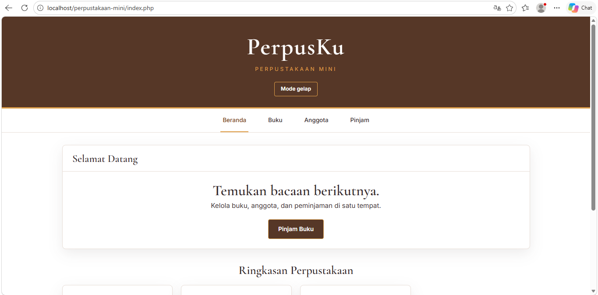

# 📚 PerpusKu — Perpustakaan Mini

Sistem Manajemen Data Interaktif untuk mengelola data buku, anggota, dan peminjaman.

## Identitas
| | |
|---|---|
| Nama | Rahma Anjani |
| NIM | 17241026 |
| Kelas | TI.5A |
| Mata Kuliah | Pemrograman Web |

## Fitur
- Ringkasan jumlah buku, anggota, dan buku yang dipinjam
- Tambah, cari, dan hapus buku
- Unggah sampul buku atau pakai sampul otomatis
- Pendaftaran anggota
- Peminjaman dan pengembalian buku
- Validasi form real-time
- Mode gelap dan terang
- Tampilan responsif (mobile-first)

## Teknologi
- HTML5 Semantik
- CSS3 (Flexbox dan Grid, tanpa framework)
- JavaScript
- PHP 7.4 atau lebih baru (data disimpan di session)

## Struktur Folder
```
perpustakaan-mini/
├── index.php          # Beranda
├── buku.php           # Data buku
├── anggota.php        # Data anggota
├── pinjam.php         # Peminjaman
├── assets/
│   ├── style.css
│   └── script.js
├── includes/
│   ├── data.php
│   ├── header.php
│   └── footer.php
├── docs/
│   ├── screenshots/   # Gambar tampilan website
│   └── Laporan Project [Rahma Anjani].docx
```
## Cara Menjalankan
1. Unduh repositori (**Code → Download ZIP**), lalu ekstrak.
2. Ubah nama folder menjadi `perpustakaan-mini` dan salin ke `htdocs` XAMPP.
3. Nyalakan Apache.
4. Buka `http://localhost/perpustakaan-mini/`.

## Pemenuhan Ketentuan
| Ketentuan | Penerapan |
|---|---|
| HTML5 Semantik | `header`, `nav`, `main`, `section`, `article`, `footer` |
| Layouting | Flexbox dan CSS Grid |
| Responsif | Mobile-first, breakpoint 600px dan 860px |
| JavaScript | Validasi form, filter buku, mode gelap, pratinjau sampul, konfirmasi hapus |
| PHP | GET untuk pencarian, POST untuk form, data input ditampilkan kembali |

## Catatan
- Data dapat hilang ketika sesi berakhir, misalnya saat browser ditutup.
- Sampul unggahan: JPG, PNG, atau WEBP, maksimal 1 MB.

## Tampilan Website

### Desktop
| Beranda | Data Buku |
|---|---|
|  |  |

| Validasi Form | Peminjaman |
|---|---|
|  |  |

### Mobile
| Beranda | Data Buku | Validasi Form | Peminjaman |
|---|---|---|---|
|  |  |  |  |
